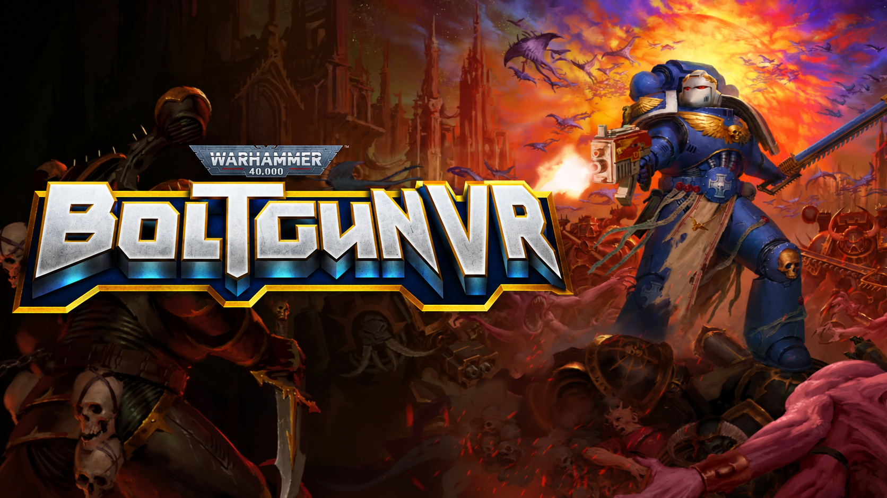

<p align="center">
  
</p>

<p align="center">
  
  
  
  
</p>

<p align="center">
  <a href="https://ko-fi.com/onitaku"></a>
</p>

<p align="center">
  <b>Bring the original Warhammer 40,000: Boltgun into PC VR.</b><br>
  A UEVR profile with motion-controller input, an in-game weapon wheel,<br>
  optional tracked 3D firearms and a tracked chainsword.
</p>

Latest release: **v1.0.1** · [Changelog](CHANGELOG.md)

<p align="center">
  <a href="docs/EASY-SETUP.md"><b>Get started →</b></a>
  &nbsp;·&nbsp; <a href="docs/CONTROLS.md">Controls</a>
  &nbsp;·&nbsp; <a href="docs/STATUS.md">Validation &amp; limits</a>
  &nbsp;·&nbsp; <a href="docs/README.es.md">Español</a>
</p>

> [!IMPORTANT]
> **Version 1.0.1 — validated in VR by the maintainer on 16 October 2026.** Sense profile v7 / 3D arsenal revision 20 / chainsword package 5. This update fixes the tracking callback crash, restores 3D weapons across save loads, recovers the chainsword and aligns supported firearm effects with their barrels. Validation covers the maintainer's PS VR2 Sense setup and tested gameplay; DLC weapons and other controller mappings are not independently certified. [Download the player package](https://github.com/rubocopter/boltgun-vr/releases/latest).

## What changes in VR

- **Motion controls.** Head-oriented movement, turning, pause/recenter mappings and PS VR2 Sense button assignments.
- **Weapon wheel.** Hold R3, tilt the right stick towards a weapon group and release. Return to the centre to cancel.
- **Optional tracked firearms.** Up to ten weapon-specific 3D replacements assembled from meshes already in the installed game; the Multi-Melta and Missile Launcher require the DLC. The mod can fall back to the original sprite when a mesh fails to load.
- **Optional chainsword.** A separate tracked model on the left controller. Attacks, damage and sounds still use the original game's mechanics.
- **Presentation tweaks.** Reduced Codex reading scale, comfort options and a normally hidden UEVR menu.

Firearms have experimental visual recoil and firing haptics on intercepted projectile spawns. Native aim and spread are preserved. Supported local muzzle effects, including attached and reused Niagara systems, follow each weapon barrel. Effects outside the exact allowlist and unhooked beam/hitscan paths retain native behavior. Physical reloads and gesture-based sword damage are not implemented.

## Install

The [v1.0.1 release](https://github.com/rubocopter/boltgun-vr/releases/latest) includes a player ZIP with the compiled native plugins and the English menu launcher. UEVR and game files are not included. Source and build instructions remain available in this repository.

1. Install your own copy of **Warhammer 40,000: Boltgun** on Windows and set up SteamVR/OpenXR with your PCVR headset and motion controllers.
2. Get [UEVR from praydog's official releases](https://github.com/praydog/UEVR/releases). Maintainers can compile the two native plugins using [build instructions](docs/BUILD.md), verify their hashes and create a local player ZIP.
3. Extract the downloaded player ZIP, run **`Boltgun VR.cmd`**, and choose **Install or update the VR profile**. Select your `UEVRInjector.exe` and choose whether to include the experimental 3D components.
4. Choose **Start Boltgun and open the UEVR frontend**, select **OpenXR**, then press **Inject** manually. If SteamVR has not generated the Boltgun Oculus Touch binding yet, inject once, close the game, and run the install option again to patch Options/Create.

For prerequisites, exact file locations, backups and restoring your previous profile, use the [guided setup](docs/EASY-SETUP.md) or [advanced install/recovery](docs/INSTALL.md). The menu never injects automatically. The only SteamVR binding patched by the installer is the generated Oculus Touch profile used by the supplied PS VR2 Sense setup. Other controller profiles have no separate mappings in this package and are not validated.

## Current development status

| Component | Evidence | What remains |
| --- | --- | --- |
| Sense controls and weapon wheel | Maintainer-confirmed VR session; offline Lua tests | Other controller mappings remain unvalidated |
| 3D firearms (revision 20) | Maintainer-confirmed gameplay and recovery across save loads | DLC coverage and individual grip preferences |
| Native muzzle bridge | Maintainer-confirmed barrel effect alignment; native harnesses | Unsupported beam/hitscan and unrelated effect paths |
| Tracked chainsword (package 5) | Maintainer-confirmed recovery and tracking | Other hardware and individual alignment preferences |

Version 1.0.1 keeps the 3D mode through supported save-load transitions and prevents stale component references from permanently disabling the firearm or chainsword modules. Two-hand aiming is explicitly opt-in. Read [validation scope and limitations](docs/STATUS.md) for the tested boundary.

## Documentation

| Playing & setup | Development & maintenance |
| --- | --- |
| [Quick start](docs/EASY-SETUP.md) · [Español](docs/INSTALACION-FACIL.es.md) | [Architecture](docs/ARCHITECTURE.md) |
| [Sense controls](docs/CONTROLS.md) | [Build & tests](docs/BUILD.md) |
| [Troubleshooting](docs/TROUBLESHOOTING.md) | [Arsenal implementation](docs/ARSENAL.md) |
| [Installation & restore](docs/INSTALL.md) | [Native muzzle bridge](docs/NATIVE-MUZZLE.md) |
| [Headset validation & limitations](docs/STATUS.md) | [Chainsword implementation](docs/CHAINSAW.md) |
| [Windows reinstall & backup](docs/REINSTALL.md) | [Source, licensing & credits](docs/SOURCE-AND-NOTICES.md) |

<details>
<summary><b>For developers</b></summary>

The active Lua modules live in `profile/scripts` and `src/lua`; the native x64 sources are in `src/native`. The repository has offline Lua/Python tests, native harnesses, isolated installer tests and a GitHub Actions validation workflow. Native build outputs remain local and are included only when deliberately assembling a player package.

```powershell
python -m pip install -r requirements-dev.txt
python -m unittest discover -s tests -p 'test_*.py' -q
python -m unittest discover -s src/native/chainsword -p 'test_*.py' -q
.\tools\Build.ps1
.\tools\Check-Repository.ps1
.\tools\Package-Setup.ps1
```

See [build requirements](docs/BUILD.md) and [repository layout](docs/REPOSITORY.md) before modifying or distributing a build.

</details>

---

**Unofficial fan project.** Not affiliated with or endorsed by Auroch Digital, Games Workshop, Focus Entertainment, praydog, Valve or Sony Interactive Entertainment. Warhammer 40,000: Boltgun and UEVR are required separately. Original game assets are not redistributed. The credited chainsword model is by Kaiser-E (CC BY 4.0). There is currently **no project-wide source-code license**; see [source and third-party notices](docs/SOURCE-AND-NOTICES.md) before reuse or redistribution.
